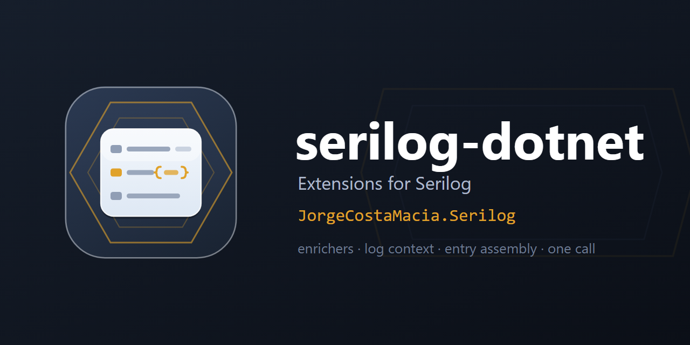

  

# serilog-dotnet

> Extensions for [Serilog](https://serilog.net/) — a logging baseline as one `LoggerConfiguration` call: the log context, thread, process and exception-detail enrichers, plus the entry assembly's version and name — shipped under `JorgeCostaMacia.Serilog`.

Part of the `JorgeCostaMacia.*` family, alongside [ddd-dotnet](https://github.com/JorgeCostaMacia/ddd-dotnet) (DDD building blocks), [quartz-dotnet](https://github.com/JorgeCostaMacia/quartz-dotnet) (Quartz.NET extensions), [bus-dotnet](https://github.com/JorgeCostaMacia/bus-dotnet) (messaging) and [http-dotnet](https://github.com/JorgeCostaMacia/http-dotnet) (ASP.NET Core).

An independent project: it builds on Serilog through its own extension point (an extension method on the `LoggerConfiguration` the host already writes) and is not affiliated with the Serilog project.

## Requirements

The **.NET 10** SDK.

## Packages

| Package | What it does |
| --- | --- |
| [JorgeCostaMacia.Serilog](https://www.nuget.org/packages/JorgeCostaMacia.Serilog/) | The logging baseline as a `LoggerConfiguration` extension (enrichers + entry-assembly properties; sinks and levels stay in config). |

## Upgrading

What each version asks of you, when it asks anything, is in [CHANGELOG.md](CHANGELOG.md).

## Contact

- [LinkedIn](https://www.linkedin.com/in/jorge-costa-macia-842817164/)
- [GitHub](https://github.com/JorgeCostaMacia/)
- [Bitbucket](https://bitbucket.org/jorgecostamacia/)
